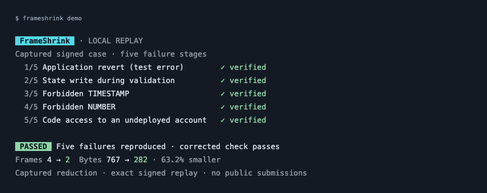

# FrameShrink

A terminal debugger that shrinks failing Ethereum frame transactions into reproducible test cases while preserving their failure evidence.

This release is a downloadable npm tarball. Nothing is published to npm or a remote Git host.

## Try the download

Requires Node.js 22.13+ (22.x) or 24+. Download `frameshrink-0.1.3.tgz`, then run:

```sh
npm exec --yes --package=./frameshrink-0.1.3.tgz -- frameshrink --help
npm exec --yes --package=./frameshrink-0.1.3.tgz -- frameshrink demo local
```

`npm exec` uses npm's cache without a global installation. The local demo verifies each of five failure stages, shows the captured reduction, and checks the corrected control. `frameshrink demo` is shorthand for this local replay. It needs Docker, but no wallet, faucet funds, Git, Bun, or public submission. Docker may download the pinned execution image on first use. On Apple Silicon, enable Docker Desktop Rosetta support for that amd64 image.



## Install

```sh
npm install --global ./frameshrink-0.1.3.tgz
frameshrink --version
frameshrink start transaction
```

The interactive workflow selects or creates a CLI wallet, obtains faucet funds, chooses combined or separate failures, confirms the original submission, reduces locally, shows changes, and confirms the correction. Previews open with O + Enter in `VISUAL`, `EDITOR`, or the system default; C + Enter continues. Candidate checks update one live row; stage summaries stay visible. Use `--verbose` to retain every check in terminal output. Activity indicators cover network, deployment and simulation waits; status labels distinguish confirmed execution, pending receipts and unconfirmed outcomes. Successful output ends with the corrected hash/link and opens it once in your default browser. Use `--no-open` or `FRAMESHRINK_NO_OPEN=1` to keep links in the terminal.

Supported controlled cases:

- Application-defined test revert.
- State write during read-only validation.
- Forbidden TIMESTAMP and NUMBER reads.
- Code access to an undeployed account.

These are owned fixtures, not arbitrary-contract repair. Other failure categories stay disabled. New-category runs deploy a v3 validator only after confirmation; setup funds it with 0.01 devnet ETH plus deployment gas. Candidates stay local. Unknown outcomes and relayer cancellations are reported without blind resubmission.

Installed/npm-exec copies keep wallet data and cases in `~/.frameshrink`. Use `FRAMESHRINK_HOME=/absolute/path` to choose another location. Source checkout commands preserve their `.runs` directory. Keys are excluded from packages, examples and Git history.

Runtime ownership is shared across updated installations at `~/.frameshrink/runtime`, independently of wallet/case storage. Simulation, replay and runtime start/stop cannot replace another updated copy's active Docker runtime. Close older releases before running this version alongside other copies.

## Source development

```sh
npm ci
npm run bootstrap
npm run build
npm test
npm run test:integration
npm run test:package -- --runtime
npm pack --pack-destination artifacts
```

Create `artifacts` before the final command. Bootstrap is a maintainer step that builds the pinned upstream dependency. Recipients of the tarball do not need it. `private: true` and `prepublishOnly` block registry publication.

The source repository also contains a browser workbench (`npm run runtime:up`, then `npm start`), full verification evidence and design notes. [Installation and packaging details](docs/PACKAGING.md) explain source builds, recovery commands and distribution. [Attribution](docs/ATTRIBUTION.md) records upstream reuse, prior work and AI assistance. MIT licensed, with bundled dependency notices included.

`frameshrink serve --json` prints one ready record or a structured startup error. Use `serve --port <number>` to select another port; `--port 0` chooses a free port. The [project overview](docs/PROJECT-OVERVIEW.md) describes the supported scope without duplicating this quick-start.
