# Architecture and trust boundaries

FrameShrink is a local TypeScript workbench for reducing owned EIP-8141 regression fixtures. The CLI and loopback HTTP server call the same reducer. The reducer rebuilds ABI data, obtains a fresh disposable signature, invokes real ethrex simulation at block 0, and passes the trace to the pinned workshop sidecar's `FrameTxValidationService` and `CheckCollector`.

```mermaid
flowchart LR
  UI[Local UI or CLI] --> Schema[Strict owned recipe schema]
  Schema --> Builder[ABI builder and disposable signer]
  Builder --> Codec[Pinned upstream codec]
  Codec --> Ethrex[Real ethrex simulation at block 0]
  Ethrex --> Policy[Pinned upstream policy validator]
  Policy --> Predicate[Failure fingerprint]
  Predicate --> Reducer[Deterministic typed reduction]
  Reducer --> Builder
  Reducer --> Bundle[Checksummed regression bundle]
  Bundle --> Replay[Clean container reconstruction and assertions]
```

## Actual scope

The local evaluator covers structural prefix rules, protocol signature validation, trace alignment, execution status, ERC-7562 opcode/storage/code checks and the fixed fixture stake policy. It does not instantiate the full sidecar mempool, reputation database, fee admission, replacement policy, gossip or relayer. Its acceptance result means the *covered checks* pass. Only the separate public demonstration establishes actual alt-mempool admission.

The fixed policy has no staking registry or whitelisted entities. Stake values are zero, and stake-requiring access is rejected. These are explicit fixture inputs, not guessed live-chain observations. Their canonical hash is part of the runtime profile and every failure fingerprint.

## State and identity

The execution image is pinned by digest and identifies ethrex commit `9aa3645d795945c64400f41a70aace0edfa7f383`. The sidecar is pinned at `2e22ff0a2898e69ea4bf5275bce1be8581a8582a`; bootstrap refuses a different or dirty checkout. The runtime uses the exported deterministic genesis, mounted readonly. There is no miner; chain ID is 9 and the head must remain block 0. Genesis code, balances and nonces are checked for the owned wallet, banned-opcode wallet and ABI sink. The profile records genesis-file hash, genesis-block hash, actual client version, account state, policy hash and both dependency identities.

Every evaluation checks the head before and after simulation. A shared exclusive lock serializes CLI and server runtime jobs. Replay stops and reconstructs only the dedicated `frameshrink-ethrex` container, then asserts identical profile/state hashes and both original/reduced failure predicates. It also checks the corrected control. No Anvil compatibility or unsupported snapshot method is assumed.

## Failure preservation

The fingerprint includes stage, upstream rule ID, normalized evidenced cause, optional entity/stable frame ID and profile/state hashes. Gas-budget normalization covers total declared prefix execution gas plus signature verification cost. TIMESTAMP failures preserve the upstream OP-011 class and stable validation-frame ID. Frame IDs survive deletion and are exported alongside wire indices.

For policy-only fixtures, candidates must have a complete real trace, successful simulation execution, successful per-frame results and unchanged state. Controlled execution failures use the strict structured predicate described below. RPC errors, missing traces, client failures or changed environments stop the run; they are never accepted as equivalent failures. Every candidate is re-encoded and re-signed, preventing a mutation from silently becoming a signature failure.

## Supported edits and claims

The reducer deterministically removes chunks of independent optional body frames, then ABI-described uint256 array elements. The validation prefix and at least one required body call remain. Quantities, atomic groups, arbitrary calldata mutations and unrecognized recipe fields are outside the edit set. The strict schema rejects them.

A final single-edit neighbor pass establishes local minimality only for those supported edits. A stopped budget returns a smaller fixture without a minimality claim. The default is at most 80 evaluations, 120 seconds between evaluations, one worker and 256 KiB input; each RPC also has an eight-second timeout. A single in-flight call may complete after the scheduling deadline, so this is not an OS-enforced wall-clock kill limit. Baseline, repeat and corrected-control checks count toward the evaluation budget.

## Local server and imports

The HTTP server binds only to `127.0.0.1:4317`, validates Host, and requires a random session token plus matching Origin for mutation. It exposes no arbitrary endpoint, RPC, key, shell command or deployment API. Imported signed payloads are decoded and inspected read-only; they cannot enter the owned builder/reducer. Imports have no portable-state claim.

Exports contain fixed filenames, setup, source, compiled artifact, recipes, signed payloads, raw reports and checksums. Replay rejects extra files, symlinks, changed checksums and a different genesis/profile. Checksums detect accidental change; they are not a signature proving a third party's bundle is trustworthy. No external setup commands are executed from a bundle.

## Toy wallets and signing

Local wallets intentionally use unconditional APPROVE bytecode, allowing controlled policy tests. A public disposable test key signs each candidate's canonical hash. Protocol signature validity is real, but the toy wallet is not a production authorization design. Never fund it with real assets or deploy the local wallet publicly. The public sponsor example uses a separate freshly generated EOA on test chain 1337, not any local toy wallet or signer.

The public proof script is a separate deliberate network action. It uses a sponsor faucet, one signed zero-value self-relay, and read-only receipt/status calls. It stores its private key with mode 0600 under ignored `.runs/`; evidence contains only public account/transaction data. An explicit primary relay reuses the exact signed payload/hash and cannot execute it twice because the account nonce is fixed.

## Unified captured-case adapter

`demo run` extends the CLI with a real owner-bound validator case. The active EOA signs a fixed validator deployment on chain 1337, funding it with 0.01 devnet ETH. Generated bytecode checks signature 0's resolved signer against its embedded owner, requires the SECP256K1 scheme and the canonical transaction digest, and approves its own execution/payment. A typed input selects whether TIMESTAMP is executed. The corrected input skips that opcode; authorization checks remain active.

`src/self-relay.ts` bounds all signed frame transactions to chain 1337, the fixed validation shape, zero-value body calls to the owner, bounded gas/fees, and typed inert arrays. `src/validator-code.ts` builds the owner-bound bytecode. `src/validator.ts` checkpoints deployment before broadcasting and verifies the matching receipt and runtime code. `src/demo.ts` captures sender/owner account state, obtains the original public rejection, schedules local reduction, reconstructs and replays the exact signed payloads, and submits the corrected reduced payload once.

The captured-case runtime is a separate pinned container on loopback port 18546, with reconstructed chain ID 1337 and relevant account code, balances and nonces from the explicit public observation block. These are sufficient for this storage-free, zero-value frame recipe; they are not a complete public-chain snapshot. Public source/policy versions are recorded when available and are not silently equated to the pinned local profile. Original and reduced local fingerprints are compared under one stable profile; public reports separately establish the matching TIMESTAMP class and actual correction success.

The case bundle contains public signed payloads and reproducible setup, never the active private key. Replay decodes and verifies those payloads rather than obtaining a new signing identity. Tests delete the fixture key before clean replay and confirm that a protocol-valid signature over a noncanonical message is refused by the validator. CLI `--json` preserves full evidence while default terminal output shows concise status lines with optional color.

## Interactive orchestration

`src/wizard.ts` uses Inquirer for wallet selection/creation, faucet actions, enabled/disabled failure choices, per-run combined/separate grouping, evaluation budgets and default-no confirmations. Named CLI keys remain outside bundles, under private `.runs/wallets/<name>` directories. Async-local wallet selection keeps concurrent operations isolated and preserves the legacy default identity.

The v2 validator recognizes two calldata mode bits: TIMESTAMP (1) and NUMBER (2), preserving v1 bytecode/bundle compatibility. A combined mode-3 case first exposes TIMESTAMP. The reducer preserves its exact fingerprint while shrinking; the first controlled correction clears that bit. A second local stage reproduces NUMBER with its own fingerprint, then the all-fixed mode-0 control passes. Exported `debug-stages.json` retains exact signed originals, reduced cases and staged corrections; clean replay verifies stage continuity and each expected failure. It never calls a later, different failure a preserving reduction of the first one.

`runDemo` exposes hooks before deployment, original submission, debug and final submission. Artifacts and transaction hashes are checkpointed before public writes. Rejected/reduced cases can continue through `start debug` with the original CLI wallet and verified profile. Pending hashes are reconciled without resending; Cancelled lifecycle responses are saved as inconclusive with their reason. Separate cases execute sequentially and stop on incomplete public execution, keeping nonce handling explicit. Explorers can expire their history, so public evidence is retained in the bundle.

## Controlled execution failures and v3 fixtures

`failure-modes.ts` defines a five-bit failure selection and deterministic stage ordering. V3 adds fixed branches for an application revert (bit 16), read-only SSTORE (8), and undeployed-owner EXTCODESIZE access (4), alongside legacy opcode bits. Execution-halting branches precede policy-only violations. The constructor's owner/canonical-signature checks are retained; old bytecode versions and saved cases remain accepted without changing their bytes.

`ownedExecutionFingerprint` handles only the two known v3 execution failures. It validates the bounded transaction and signature, checks the profile's exact owner-bound v3 bytecode, verifies the selected branch, frame 0, expected revert selector or static-violation detail, and the pinned client's structured abort fields. It records a `local-execution` fingerprint rather than asserting successful traced execution. Replay evaluates every stage with its correct evidence predicate. Unknown halt reasons, wrong frame/data, invalid signatures and RPC/trace failures are refused. Policy-only fixtures retain the original complete successful-execution/trace requirement.
